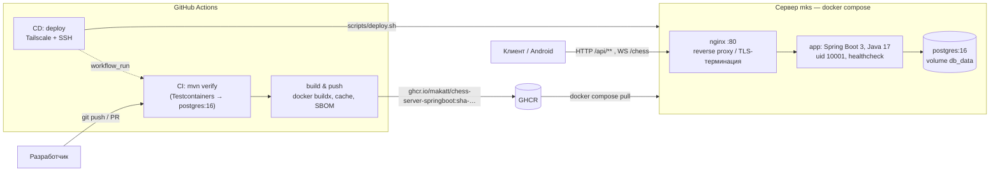
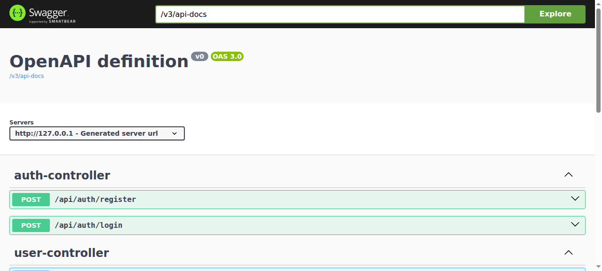

# chess-server-springboot

[](https://github.com/makatt/chess-server-springboot/actions/workflows/ci.yml)
[](https://github.com/makatt/chess-server-springboot/actions/workflows/cd.yml)


Инфраструктура вокруг реального сервиса: шахматный сервер (REST + WebSocket) упакован
в multi-stage образ, поднимается одним `docker compose up`, проходит тесты на настоящем
PostgreSQL в CI, публикуется в GHCR и автоматически деплоится на сервер по SSH
через Tailscale. Хост-часть описана Ansible-ролью.

> Репозиторий показывает полный путь «код → образ → стенд → прод»: Dockerfile,
> docker-compose, nginx как reverse proxy, healthcheck-и, GitHub Actions CI/CD,
> Infrastructure as Code и README со схемой.

## Что это за сервис

Шахматный сервер на Spring Boot 3 / Java 17: регистрация и логин (bcrypt), матчмейкинг
и игровые комнаты, партии по WebSocket в реальном времени, история матчей и ходов в
PostgreSQL, статистика и рейтинг игроков, OpenAPI-документация. Вокруг приложения
собрана вся эксплуатационная обвязка — она и есть предмет этой работы.

## Схема



* наружу публикуется только nginx и только на `127.0.0.1:8080` — БД и приложение живут
  во внутренней compose-сети;
* схема БД создаётся init-скриптом `docker/postgres/init/01_schema.sql` — тот же файл
  применяется в интеграционных тестах, поэтому расхождение «тесты зелёные, прод нет» не проходит;
* CD не запускается, если CI упал (`workflow_run` + `conclusion == success`).

## Быстрый старт

```bash
git clone https://github.com/makatt/chess-server-springboot.git
cd chess-server-springboot
cp .env.example .env          # задайте POSTGRES_PASSWORD
docker compose up -d --build  # nginx + app + postgres
curl -fsS http://127.0.0.1:8080/actuator/health
```

* Swagger UI: <http://127.0.0.1:8080/swagger-ui.html>
* Проверка состояния: `docker compose ps` (все сервисы `healthy`), `make verify`



```
NAME                 IMAGE                STATUS                   PORTS
chess-server-app     chess-server:local   Up 3 minutes (healthy)   8080/tcp
chess-server-db      postgres:16-alpine   Up 3 minutes (healthy)   5432/tcp
chess-server-nginx   nginx:1.27-alpine    Up 3 minutes (healthy)   127.0.0.1:8080->80/tcp
```

## Что проверено руками

| Проверка | Команда | Результат |
|---|---|---|
| юнит/интеграционные тесты | `./mvnw verify` | 3 теста, 0 падений (Testcontainers поднимает `postgres:16-alpine` и применяет `01_schema.sql`) |
| сборка образа | `docker compose up -d --build` | `chess-server:local`, 499 МБ |
| все контейнеры живые | `docker compose ps` | app / db / nginx — `healthy` |
| проба через nginx | `curl /healthz`, `curl /actuator/health` | `200 ok`, `{"status":"UP"}` |
| регистрация → логин → статистика | `POST /api/auth/register`, `POST /api/auth/login`, `GET /api/matches/player/1/stats` | `200`, `user_id: 1`, `{"total":0,"rating":1000}` |
| WebSocket через nginx | `curl` с заголовками `Upgrade: websocket` на `/chess` | `101 Switching Protocols` |
| данные в БД | `psql -c '\dt chess.*'` | 5 таблиц (`users`, `user_profile`, `rooms`, `matches`, `match_moves`) |

## Эндпоинты

| Метод | Путь | Назначение |
|---|---|---|
| `POST` | `/api/auth/register` | регистрация (bcrypt-хэш пароля) |
| `POST` | `/api/auth/login` | логин, возвращает `user_id` |
| `GET` | `/api/matches/player/{id}` | матчи игрока |
| `GET` | `/api/matches/{matchId}/moves` | ходы матча |
| `GET` | `/api/matches/player/{id}/stats` | статистика и рейтинг |
| `WS` | `/chess` | игровая сессия в реальном времени |
| `GET` | `/actuator/health`, `/actuator/health/readiness` | пробы для healthcheck-ов |
| `GET` | `/swagger-ui.html` | OpenAPI-документация |

## Переменные окружения

| Переменная | По умолчанию | Описание |
|---|---|---|
| `POSTGRES_DB` / `POSTGRES_USER` | `chess` | база и роль postgres |
| `POSTGRES_PASSWORD` | — | **обязательна**: без неё `docker compose` падает сразу |
| `HTTP_PORT` | `8080` | порт nginx на `127.0.0.1` |
| `APP_IMAGE` | `chess-server:local` | образ приложения: локальная сборка или тег из GHCR |

## CI (`.github/workflows/ci.yml`)

1. `./mvnw verify` — сборка и тесты; интеграционные тесты поднимают `postgres:16-alpine`
   через Testcontainers и проверяют регистрацию → логин → статистику (ломается, если
   SQL-схема разойдётся с JPA-сущностями);
2. `docker buildx` → `ghcr.io/makatt/chess-server-springboot` с тегами `main`, `sha-<commit>`, semver
   на тегах, кэшем GHA, provenance и SBOM.

## CD (`.github/workflows/cd.yml`)

Запускается после успешного CI на `master` (или вручную): подключается к tailnet,
заходит по SSH и выполняет `scripts/deploy.sh <образ>` — обновляет рабочую копию,
`docker compose pull`, перезапуск, ожидание health-пробы через nginx. Не поднялся —
джоб падает вместе с логами контейнера.

Рабочий каталог на хосте по умолчанию — `~/apps/chess-server` (создаётся один раз
`git clone`, дальше обновляется самим скриптом); путь переопределяется `vars.DEPLOY_DIR`.

Нужные секреты/переменные репозитория:

| Тип | Имя | Значение |
|---|---|---|
| secret | `DEPLOY_SSH_KEY` | приватный ключ деплоя (публичная часть — в `authorized_keys` на хосте) |
| secret | `TS_OAUTH_CLIENT_ID`, `TS_OAUTH_SECRET` | OAuth-клиент Tailscale с тегом `tag:ci` |
| var | `DEPLOY_HOST` | адрес хоста в tailnet |
| var | `DEPLOY_USER`, `DEPLOY_DIR` | пользователь и каталог репозитория на хосте |

## Ansible

```bash
cd ansible
cp inventory.example.ini inventory.ini
ansible-galaxy collection install -r requirements.yml
ansible-playbook -K -i inventory.ini site.yml   # -K спрашивает пароль sudo
```

Роль `app_host`: пользователь деплоя + SSH-ключи, docker и compose-плагин,
рабочая копия репозитория, `.env` с паролем, сгенерированным на месте,
systemd-юнит для автозапуска стека; опционально хостовый nginx и ufw
(по умолчанию выключены, чтобы роль не меняла сетевой доступ без явного запроса).
Подробности — в [`ansible/roles/app_host/README.md`](ansible/roles/app_host/README.md).

## Безопасность

* пароли и ключи — только в `.env` (в `.gitignore`) и в секретах GitHub Actions; в репозитории секретов нет;
* отсутствие `POSTGRES_PASSWORD` — немедленная ошибка конфигурации, а не дефолтный пароль;
* контейнер приложения работает не от root (`uid 10001`), наружу порты приложения не публикуются;
* `/actuator/health` не отдаёт детали (`show-details=never`), экспонированы только `health` и `info`;
* nginx добавляет `X-Content-Type-Options`, `X-Frame-Options`, `Referrer-Policy` и отдельно
  прокидывает WebSocket-заголовки.

## Структура

```
.
├── Dockerfile                 # multi-stage: maven build → JRE, non-root, healthcheck
├── docker-compose.yml         # nginx + app + postgres, health-условия, volume
├── .env.example               # переменные окружения без секретов
├── Makefile                   # make up / logs / test / deploy
├── docker/
│   ├── nginx/nginx.conf       # reverse proxy, WebSocket upgrade, gzip
│   └── postgres/init/01_schema.sql   # схема БД (тот же файл в тестах)
├── scripts/deploy.sh          # деплой образа на хост (вызывается из CD)
├── ansible/                   # роль app_host: docker, юзер, .env, systemd, nginx, ufw
├── .github/workflows/         # ci.yml (test → GHCR), cd.yml (deploy)
└── src/                       # Spring Boot приложение (REST + WebSocket + JPA)
```

## Локальная разработка

```bash
make test     # интеграционные тесты на PostgreSQL в контейнере
make up       # поднять стек
make logs     # логи всех сервисов
make ps       # состояние и healthcheck
make deploy IMAGE=ghcr.io/makatt/chess-server-springboot:sha-<commit>   # тот же скрипт, что в CD
```

Для тестов нужен запущенный Docker: Testcontainers сам поднимает `postgres:16-alpine`
и применяет ту же схему, что и compose. На Docker 29+ API-версия клиента зафиксирована
в `pom.xml` (`docker.api.version`), иначе docker-java по умолчанию просит устаревшую 1.32.

---

Автор: Максим Катаван · [github.com/makatt](https://github.com/makatt)
